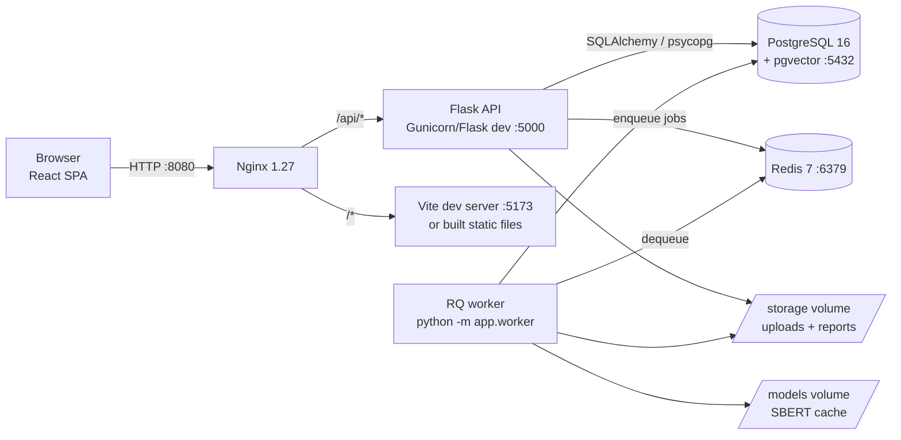
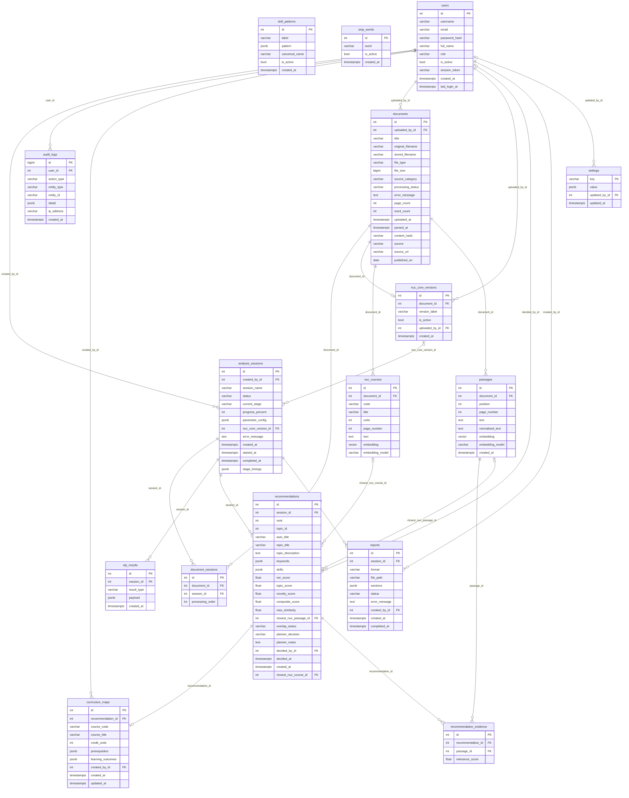

# Thesis facts pack: SkillBridge (NLP-RS)

Everything below was taken from the repository (branch `feature/skillbridge-ui`, commit
`76b8209`), the development database, the git history and the stored results, on
28 Sep 2026. Where a fact could not be established from those sources it is marked **UNKNOWN**.
Machine-readable copies are in [`results/`](results/); screenshots are in
[`screenshots/`](screenshots/).

Terms: in the code a *theme* is what the interface calls a *topic*, and a *passage* is what
the interface calls an *extract* (docs/PLAIN_LANGUAGE.md). Session 13 ("Real corpus:
plain-language topics (merged, named)") is the final real-corpus analysis.

---

## A. Project summary

| Item | Fact |
|---|---|
| Title (repository) | NLP-RS: NLP-Driven Curriculum Recommendation System (README.md) |
| Product name in the interface | SkillBridge (since commit `fb7c977`, 28 Sep 2026) |
| Institution | Department of Computer Science, Faculty of Computing, University of Uyo (README.md) |
| Degree | B.Sc. Computer Science final-year project (README.md) |

**Problem (from the project brief, §1).** Under the National Universities Commission (NUC) Core
Curriculum and Minimum Academic Standards (CCMAS), about 70% of the Computer Science curriculum
is fixed nationally; the remaining 30% is designed by each university. That 30% is decided in
committee meetings "based on opinion" rather than on evidence of what employers and policy ask
for.

**Aim.** A web application in which curriculum planners upload job adverts and policy,
institutional and academic documents, and an NLP pipeline proposes candidate course topics for
the university-designed 30%, checked by meaning against the fixed NUC 70% core and ranked with
the evidence behind them. People decide; the system never changes the curriculum itself.

**Objectives as actually implemented** (each is in the code and tested):

1. Document management: upload PDF, DOCX and TXT (≤ 25 MB each), validate type and content,
   store under UUID names, reject exact duplicates (SHA-256), archive/delete, edit source
   details (title, source, link, publication date).
2. Text processing: light cleaning (layout noise, URLs, e-mail addresses removed), sentence
   splitting with spaCy, grouping into 3–5-sentence extracts, a normalised copy for TF-IDF, and
   SBERT embeddings stored in PostgreSQL/pgvector.
3. Analysis per session (background job): TF-IDF keywords, skill extraction (spaCy
   EntityRuler with 302 patterns), topic discovery (BERTopic with UMAP + HDBSCAN), merging of
   near-duplicate topics, course-style topic names, comparison with every NUC core course,
   scoring and ranking (top 20 kept).
4. Evidence: every suggested topic shows its score out of 100 and three parts, its keywords, a
   plain "Why this is recommended" description, an example extract with its source, the 8 most
   representative extracts and the closest NUC course.
5. Review workflow: Accept / Reject / Discuss later with notes, course design for accepted
   topics (code, title, 1–3 credit units, prerequisites, learning outcomes), proposed-courses
   view with the 30% credit-unit allowance, one-click DOCX report (PDF in Docker).
6. Administration: users and three roles enforced on the server, NUC core versions, settings,
   skill patterns, stop words, NUC course exclusions, course-name catalogue, activity (audit)
   log with CSV export.
7. Evaluation tooling: NER precision/recall/F1 and Cohen's kappa, BERTopic vs LDA coherence,
   overlap AUC and threshold calibration, pipeline benchmarks, SUS kit.

**Scope** (brief §1): Computer Science, Software Engineering, Cybersecurity and IT; English
only; PDF/DOCX/TXT; corpus period 2020–2026; web only (Chrome, Firefox, Edge); pre-trained
models only (no model training).

**Limitations and items not done** (from the code and repository):

- *In-app job-advert collector*: on hold (owner's decision, 27 Sep 2026). A separate command-line
  collector exists (`tools/corpus_collector`, MyJobMag listing/job pages, optional Remotive API,
  robots.txt obeyed, 3–5 s between requests, ≤ 150 requests per run; Jobberman and LinkedIn are
  never scraped).
- *Login rate limiting*: `Flask-Limiter==4.1.1` is pinned in `backend/requirements.in`, but no
  code in `backend/app` uses it, so login is **not** rate-limited (brief §9 asked for it).
- *Production deployment*: only the development Compose stack and `nginx/dev.conf` exist; no
  HTTPS/production Nginx configuration or hosting (hosting options were planned, not done).
  `docs/ARCHITECTURE.md` and `docs/DATABASE.md` do not exist (this pack covers their content).
- *PDF reports natively on Windows*: WeasyPrint needs Pango, which is missing natively; PDF
  works in the Docker image, DOCX works everywhere.
- *libmagic natively on Windows*: absent, so upload checks use built-in file signatures only
  (Docker images install libmagic).
- *Evaluation with people is pending*: NER gold labels, overlap labels and SUS sessions have
  not been collected (section M), so NER P/R/F1, overlap AUC and SUS are **UNKNOWN**.
- *Overlap threshold not calibrated*: 0.80 is the brief's default; on session 13 no topic
  exceeds it (closest-course similarities 0.45–0.73), so no topic is flagged "May already be in
  NUC core". Calibration awaits the labelled pairs.
- *Corpus*: one policy document, no institutional or academic documents; 55 job adverts
  collected in July–September 2026 (section E).
- *Two documents lack source/date metadata* ("linkedin cybersecurity security engineer" and the
  NDEPS policy PDF has no publication date recorded); nothing was invented for them.
- *Stored descriptions of older sessions* (e.g. session 9) still use the pre-plain-language
  wording ("A theme found in 41 passages…"); they are stored data from before that change.
- Mockup features not built (DECISIONS.md, Phase 6): notifications, forgot password, course
  level/semester, per-document skills panel, weight sliders.

---

## B. Development timeline (git history)

The repository has 88 commits on this branch. The first attempt (commits `aa42ab2` to
`7900080`, 23–24 Sep 2026, "Sprint 1–6", with a Vue frontend) was removed by `8a833fe` "Clear
codebase to start afresh" (24 Sep 2026 12:58); development restarted in phases.

| Phase | Branch | Dates (commit times) | Summary | Merge commit |
|---|---|---|---|---|
| 0 Scaffold | `feature/phase-0-scaffold` (+ `feature/dev-infra`) | 24 Sep 2026 14:04–16:55 | Flask app factory, health endpoint, RQ worker, React/Vite/Tailwind/shadcn shell, Docker Compose (Postgres+pgvector, Redis, worker, Nginx), exact dependency pins, auto-created test database | `61d8d2d`, `ffd3d7e` |
| 1 Data model, auth, roles, audit | `feature/phase-1-auth` | 24 Sep 2026 21:56 | All models + migration `0001_initial_schema`, seed command (skill patterns, stop words), cookie sessions + CSRF, RBAC, audit log, admin users API; login, profile, users, 403 screens | `137086a` |
| 2 Documents and ingestion | `feature/phase-2-documents` | 24 Sep 2026 23:55 | Upload validation, parsers, cleaning, passages, normalisation, SBERT embeddings, storage, ingestion job, documents + NUC core APIs and screens | `9b6bc30` |
| 3 Analysis pipeline | `feature/phase-3-pipeline` | 25 Sep 2026 05:53 | TF-IDF, EntityRuler skills, BERTopic, titles, NUC overlap, scoring; sessions API and background job with stage progress; benchmark; session screens | `e8bebb2` |
| 4 Evidence and review | `feature/phase-4-review` | 25 Sep 2026 06:11–06:47 | Results, recommendations, decisions and mapping API; evidence dashboard, review, detail, mapping, proposed curriculum | `4c83d59` |
| 5 Reports, dashboard, admin | `feature/phase-5-reports-admin` | 25 Sep 2026 07:53–12:48 | PDF/DOCX reports, dashboard summary, admin settings/skill patterns/stop words/audit log (+CSV) | `13ec0fd` |
| 6 Evaluation, real corpus, release work | `feature/phase-6-release`, then `feature/skillbridge-ui` | 25 Sep 2026 18:01 – 28 Sep 2026 03:16 (not merged) | Docker PDF reports, real-PDF cleaning, corpus collector, stable HDBSCAN, document-weighted and specificity scoring, course-level overlap, NUC exclusions, scores out of 100, lecturer workflow, evaluation scripts, topic merging and course-style names, plain-language pass, SkillBridge redesign | — |

Phase 6 commits in order:

- `664c863` 25 Sep 2026 18:01: Docker: working image builds, real PDF reports and offline model loading
- `9f4bb0c` 25 Sep 2026 19:28: Cleaner passages from real PDFs: justified text, wrapped lists, fragment lists
- `0954d65` 25 Sep 2026 19:53: Add a polite job-advert corpus collector (tools/corpus_collector)
- `7c553b7` 25 Sep 2026 20:05: Collector: --cap FAMILY=N for a per-family cap (e.g. product_agile=4)
- `f8b3f13` 25 Sep 2026 20:28: Better theme titles on the real corpus: skill-name matching and advert boilerplate
- `603e77f` 25 Sep 2026 21:07: Collector: --only-family mode with MyJobMag job-title pages, strong deny for teaching/sales posts
- `2280bdf` 25 Sep 2026 21:38: Stable theme discovery (HDBSCAN min_samples=3) and cleaner titles
- `d21d3b8` 27 Sep 2026 13:29: Frontend: route-level code splitting and a clearer composite score display
- `ad9cebb` 27 Sep 2026 13:32: Add start-demo.ps1 (one-click lightweight start) and docs/DEMO.md
- `82303f0` 27 Sep 2026 16:41: Document-weighted theme strength
- `2c04e07` 27 Sep 2026 16:41: Course-level NUC overlap: compare themes with whole CCMAS courses
- `6c087ed` 27 Sep 2026 17:08: Exclude generic NUC courses from the overlap comparison
- `f1b8186` 27 Sep 2026 17:52: Admins can find and edit their own name and email
- `1377214` 27 Sep 2026 17:52: Dashboard: every card links somewhere useful; compact recent sessions
- `a5f1250` 27 Sep 2026 17:52: Show scores out of 100 everywhere; exact decimals behind a toggle
- `cfd1a82` 27 Sep 2026 18:18: Specificity-weighted skill demand and square-root theme strength
- `d23a522` 27 Sep 2026 19:09: Lecturer workflow: clear decisions, Design course, progress steps, one-click report
- `263f543` 27 Sep 2026 19:43: Evaluation scripts: NER P/R/F1 + kappa, BERTopic vs LDA coherence, overlap AUC and calibration, real benchmark, SUS kit
- `be6c85b` 27 Sep 2026 22:17: Merge near-duplicate topics, course-style names, plain descriptions, document sources
- `f2461e1` 27 Sep 2026 22:57: Plain-language pass across the app
- `a6d42de` 27 Sep 2026 23:12: Tidy keywords and review wording
- `8ab110d` 27 Sep 2026 23:32: Docs: topic merging and naming decisions, plain-language table, annotator guide
- `5f0a25d` 28 Sep 2026 00:16: Add the approved SkillBridge design (spec, page mockups, login photo)
- `fb7c977` 28 Sep 2026 00:16: SkillBridge stage 1: brand tokens, Plus Jakarta Sans, Keystone logo, restyled primitives
- `b7ebc78` 28 Sep 2026 02:11: SkillBridge stage 2: sidebar, top bar and sign-in page
- `dc98ebc` 28 Sep 2026 02:55: SkillBridge stage 3: restyle every page to the approved mockups
- `76b8209` 28 Sep 2026 03:16: SkillBridge stage 4: checks, fixes and screenshots per role

---

## C. Technology stack (exact versions)

Sources: `frontend/package.json` (exact pins), `backend/requirements.in` and the uv lockfiles
`backend/requirements*.txt`, `backend/Dockerfile`, `frontend/Dockerfile`, `docker-compose*.yml`.

**Frontend**

| Component | Version |
|---|---|
| React / React DOM | 19.3.0 |
| TypeScript | 6.0.3 |
| Vite | 8.3.0 (@vitejs/plugin-react 6.1.1) |
| React Router | 8.4.0 |
| Tailwind CSS (+ @tailwindcss/vite) | 4.3.3 |
| shadcn (CLI/styles) / radix-ui | 4.21.0 / 1.6.7 |
| TanStack Query | 5.103.2 |
| Axios | 1.20.0 |
| React Hook Form / @hookform/resolvers / Zod | 7.88.0 / 5.9.1 / 4.6.5 |
| Recharts | 3.10.1 |
| lucide-react | 1.48.0 |
| sonner (toasts) | 2.0.8 |
| class-variance-authority / cn / tw-animate-css | 0.7.1 / 0.4.0 / 1.4.0 |
| Font | @fontsource-variable/plus-jakarta-sans 5.3.0 |
| Node.js | 24 in Docker (`node:24-alpine`); v24.19.0 and npm 11.17.0 on the development laptop |

**Backend** (Python 3.11 in Docker `python:3.11-slim`; Python 3.13.15 on the development laptop)

| Component | Version |
|---|---|
| Flask | 3.1.3 (Werkzeug 3.1.8, Jinja2 3.1.6) |
| Flask-SQLAlchemy / SQLAlchemy | 3.1.1 / 2.0.54 |
| Flask-Migrate / Alembic | 4.1.0 / 1.20.0 |
| Flask-Login / Flask-WTF (CSRF) | 0.6.3 / 1.3.0 |
| bcrypt | 5.0.0 |
| Pydantic / email-validator | 2.13.5 / 2.3.0 |
| psycopg (binary) / pgvector (Python) | 3.3.6 / 0.5.0 |
| Gunicorn | 26.2.0 (Docker image CMD: 3 workers, timeout 120 s) |
| python-dotenv / truststore | 1.2.3 / 0.10.4 |
| Flask-Limiter | 4.1.1 (pinned, not used) |

**Database and queue**

| Component | Version |
|---|---|
| PostgreSQL | PostgreSQL 16.15 (Debian 16.15-1.pgdg12+2) (image `pgvector/pgvector:pg16`) |
| pgvector extension | 0.8.6 |
| Redis | image `redis:7-alpine` (redis-py 8.1.0) |
| RQ | 2.12.0 (a `SimpleWorker`, jobs run in the worker process) |
| Alembic head | `0005_document_source` (migrations 0001–0005) |

**NLP**

| Component | Version |
|---|---|
| spaCy / model | 3.8.16 / `en_core_web_sm` 3.8.0 |
| sentence-transformers / model | 6.1.0 / `all-MiniLM-L6-v2` (384 dimensions, as stored) |
| transformers / tokenizers / huggingface-hub | 5.17.0 / 0.23.2 / 1.33.0 |
| PyTorch | 2.14.0+cpu (CPU-only index) |
| BERTopic | 0.17.4 |
| umap-learn / pynndescent / numba | 0.5.12 / 0.6.0 / 0.67.0 |
| hdbscan | 0.8.44 |
| scikit-learn / scipy / numpy / pandas | 1.9.1 / 1.17.1 / 2.4.6 / 3.0.6 |
| NLTK (Porter stemmer only) | 3.10.3 |
| Gensim (evaluation only) | 4.4.0 |

**Parsing and reports**

| Component | Version |
|---|---|
| PyMuPDF | 1.28.2 |
| python-docx | 1.2.0 (DOCX input and DOCX reports) |
| python-magic | 0.4.27 (+ libmagic1 in Docker) |
| charset-normalizer | 3.5.1 |
| lxml | 6.1.3 |
| WeasyPrint (PDF reports) | 70.0 (+ Pango/HarfBuzz and fonts-dejavu-core in Docker) |

**Testing and quality tools**

| Component | Version |
|---|---|
| pytest / pytest-cov | 9.1.1 / 7.1.0 |
| ruff / black | 0.16.8 / 26.5.1 |
| uv (lockfile generation) | 0.12.18 |
| Vitest / @vitest/coverage-v8 | 5.0.1 / 5.0.1 |
| Testing Library (react / user-event / jest-dom) | 16.3.3 / 14.6.7 / 7.0.1 |
| jsdom | 30.1.1 |
| ESLint / typescript-eslint | 10.11.0 / 8.70.1 |
| Prettier (+ tailwind plugin) | 3.9.9 (0.8.1) |
| Screenshots (outside the repo) | Playwright 1.55 with Microsoft Edge (headless) |

---

## D. System architecture

| Component (Compose service) | What it does | Talks to |
|---|---|---|
| `nginx` (`nginx:1.27-alpine`, host port `${HTTP_PORT:-8080}`→80) | Single entry point: `/api/` → backend:5000, everything else → frontend:5173 (with the HMR websocket); `client_max_body_size 100m`; `proxy_read_timeout 120s` | backend, frontend |
| `frontend` (Node 24, Vite dev server, port 5173) | Serves the React single-page app; in development proxies `/api` to the backend (`VITE_API_PROXY_TARGET`) | backend (via Nginx or proxy) |
| `backend` (Python 3.11; Flask dev server in Compose, Gunicorn 3 workers in the image; host port `${BACKEND_HOST_PORT:-5000}`) | REST API under `/api` (59 routes, section H); cookie sessions + CSRF; runs `flask db upgrade` on start | PostgreSQL, Redis, storage volume |
| `worker` (same image, `python -m app.worker`, `restart: unless-stopped`) | RQ `SimpleWorker`: document ingestion jobs, session analysis jobs, report jobs; keeps spaCy/SBERT loaded between jobs | Redis (queue), PostgreSQL, storage and models volumes |
| `postgres` (`pgvector/pgvector:pg16`, host port `${POSTGRES_HOST_PORT:-5432}`) | All data, including 384-dimension embeddings in pgvector `vector` columns; volume `postgres-data` | — |
| `redis` (`redis:7-alpine`, host port `${REDIS_HOST_PORT:-6379}`) | Job queue for RQ | — |
| Volumes | `storage-data` (/data/storage: uploads and reports under UUID names), `models-data` (/data/models: Hugging Face cache), `postgres-data` | — |

Flow of a request: the browser calls `/api/...` on the same origin, sends the session cookie
(`nlprs_session`, HttpOnly, SameSite=Lax, Secure in production, 8-hour lifetime) and, for
state-changing requests, the `X-CSRFToken` header. Long work is queued: upload →
`app.tasks.ingestion.ingest_document`; run session → `app.tasks.analysis.run_session`; report
→ `app.tasks.reports.generate_report`. The interface polls the session (and document/report)
status every 2–3 s while a job runs. Responses use the envelope `{"success": true, "data": …}` or
`{"success": false, "error": {"code", "message", "details"}}`.

Lightweight mode (used on the development laptop): `docker-compose.services.yml` runs only
PostgreSQL and Redis; the API (`flask --app wsgi run`), the worker and Vite run natively
(`start-demo.ps1`), with the app at http://localhost:5173.

---

## E. Data and corpus (session 13)

Source: development database, `results/session13_documents.csv`, `results/facts_raw.json`.

| Measure | Value |
|---|---|
| Documents in the analysis | 56 |
| By type | 55 job adverts, 1 policy document; 0 university documents, 0 academic papers |
| By source | MyJobMag 54, UNKNOWN (not recorded) 1, NITDA 1 |
| By file type | TXT 55, PDF 1 |
| Publication dates (where recorded) | 2026-07-07 to 2026-09-25; by month: 2026-07: 2, 2026-08: 1, 2026-09: 51; 2 documents without a date |
| Words | 30,822 |
| Extracts (passages) | 417 (job adverts 301, policy documents 116) |
| Upload dates | 25 Sep 2026, 19:06–20:12 UTC (all 56 documents) |

The policy document is "National Digital Economy Policy and Strategy (2020-2030)" (PDF, 41
pages, 10,239 words, 116 extracts), source recorded as NITDA, publication date not recorded.
The job adverts were collected with the command-line collector from MyJobMag (54) plus one
advert copied manually from LinkedIn ("linkedin cybersecurity security engineer", no source or
date recorded). The full list with titles, sources, dates, words and extracts is in
`results/session13_documents.csv`.

**NUC CCMAS core** (NUC core version 1)

| Measure | Value |
|---|---|
| Version label / document | NUC CCMAS Computing 2023 / "Computing CCMAS 2023 FINAL (1)" |
| Pages / words / extracts | 228 / 74,717 / 1,000 |
| Courses found (header "CODE NNN: Title (N Units …)") | 118 |
| Courses compared | 86 |
| Courses left out | 32 — code prefix GST: 4, title keyword siwes: 11, title keyword final year project: 14, title keyword industrial work experience: 3 |
| Exclusion rule (setting `nuc_course_exclusions`) | code prefixes: GST; title keywords: SIWES, Industrial Work Experience, Industrial Training, Final Year Project, Seminar (case-insensitive) |
| Why | General studies, SIWES, project and seminar courses describe work experience or communication rather than subject content; on the real corpus SIWES/project courses were the closest "course" for 5 of the top 20 themes (DECISIONS.md, Phase 6) |

Course codes by prefix: BUA 1, COS 5, CSC 12, CYB 18, DST 1, DTS 13, ENT 2, GST 4, ICT 10, IFT 17, INS 13, MTH 6, PHY 4, SEN 10, STA 2. The excluded courses are listed in
`results/facts_raw.json` (`nuc_core.excluded_courses`).

**Skills taxonomy and other lists**

| List | Size |
|---|---|
| Skill patterns (all active) | 302 patterns: LANGUAGE 33, TOOL 112, SKILL 120, CERT 37; 172 distinct canonical skills; 299 phrase patterns and 3 token patterns |
| Stop words (domain) | 116 active (81 were seeded; the rest were added by the administrator) |
| Course-style topic names (setting `topic_name_catalogue`) | 120 names (ACM/IEEE CS2023 knowledge areas and common NUC course titles) |

---

## F. Processing pipeline (as implemented)

### F1. Ingestion (once per uploaded document; `app.tasks.ingestion.ingest_document`)

1. **Validation** (`services/ingestion/validation.py`): extension PDF/DOCX/TXT; size ≤ 25 MB
   (`MAX_FILE_BYTES = 25 × 1024 × 1024`; whole request ≤ 100 MB); content check with libmagic
   where available plus each format's signature (PDF header, DOCX zip containing
   `word/document.xml`, no NUL bytes in text); exact duplicates rejected by SHA-256.
2. **Parsing** (`parsers.py`): PDF with PyMuPDF page by page (encrypted PDFs rejected; fewer than
   50 extractable characters per page on average → "scanned PDF, OCR is not supported"); DOCX
   with python-docx (paragraphs and tables); TXT decoded UTF-8 → Windows-1252 →
   charset-normalizer → Latin-1.
3. **Light cleaning** (`cleaning.py`, keeps wording and casing): Unicode NFKC; words hyphenated
   across line breaks rejoined; headers/footers removed when a line is among the first/last 2
   lines of a page, has ≤ 12 words and repeats (digits ignored) on more than half of the pages
   of a document with ≥ 3 pages; page-number lines, table-of-contents dot leaders, URLs and
   e-mail addresses removed; bullet markers removed and each bullet item ends with a full stop;
   short headings get a full stop (only at paragraph boundaries, never after a connector word);
   lines joined into paragraphs.
4. **Sentence splitting**: spaCy `en_core_web_sm` (setting `spacy_model`) with the `ner`
   component disabled; sentences without letters dropped; a sentence longer than 200 words is
   cut into 200-word chunks.
5. **Extracts (passages)** (`passages.py`, settings `passage_sentences` {min 3, max 5} and
   `passage_words` {min 100, max 200}): a passage closes when it has ≥ 3 sentences and ≥ 100
   words, or reaches 200 words, or has 5 sentences and at least 50 words; a sentence that would
   exceed 200 words starts a new passage; a final fragment (< 3 sentences and < 50 words) joins
   the previous passage if the result stays ≤ 200 words. Page number = page of the first
   sentence (PDF only).
6. **Normalised copy for TF-IDF** (`preprocessing/normalise.py`): lowercase lemmas; spaCy
   English stop words plus the domain stop words removed; punctuation, numbers, tokens without
   letters and tokens shorter than 2 characters removed; multi-word stop phrases removed.
7. **Embeddings** (`embeddings/encoder.py`): sentence-transformers `all-MiniLM-L6-v2` (setting
   `sbert_model`) on the CPU, batch size 32, `normalize_embeddings=True` (L2-normalised, so
   cosine = dot product), 384 dimensions; stored in `passages.embedding` with
   `passages.embedding_model`.
8. **NUC core only** (`ingestion/courses.py`): courses found with the regular expression
   `\b(?P<prefix>[A-Z]{3})\s?(?P<number>\d{3})\s*[:\-–]?\s*(?P<title>[^\n]{3,120}?)\s*\(\s*(?P<units>\d{1,2})\s*Units?\b`;
   a course's text runs to the next header, capped at 500 words; courses under 15 words are
   skipped; a repeated code keeps its longest text. Course embedding = L2-normalised mean of the
   SBERT embeddings of its consecutive 200-word chunks.

### F2. Session analysis (`app.tasks.analysis.run_session` → `services/analysis.run_analysis`)

Stages and the progress shown when each starts: validating 5% → loading 10% → keywords 20% →
skills 35% → embeddings 50% → themes 55% → overlap 80% → scoring 90% → completed 100%.
Only passages of the selected (non-NUC) documents are modelled; the NUC core is only compared
against.

**Parameters of session 13** (snapshot `parameter_config`): weights ner 0.40, topic 0.35,
novelty 0.25; similarity_threshold 0.80; max_recommendations 20; min_topic_size 5;
evidence_per_recommendation 8; sbert_model `all-MiniLM-L6-v2`; spacy_model `en_core_web_sm`.
`random_state` = 42 (code default).

1. **Keywords (TF-IDF)** — `services/tfidf/keywords.py`, scikit-learn `TfidfVectorizer` on the
   normalised text (active stop words removed again at analysis time):
   `ngram_range=(1, 2)`, `token_pattern=r"(?u)[^\s]+"`, `lowercase=False`, `sublinear_tf=True`,
   `min_df=2`, `max_df=0.85` (both relaxed to 1 / 1.0 when there are fewer than 10 passages or
   filtering leaves no terms). Term score = mean TF-IDF weight over the passages, overall and per
   document category; top 30 kept.
2. **Skills** — `services/ner/skills.py`: spaCy `en_core_web_sm` loaded without
   `parser, lemmatizer, tagger, attribute_ruler, senter`; an `entity_ruler` is added **before**
   `ner` with `phrase_matcher_attr="LOWER"` and `overwrite_ents=True`, loaded with the active
   skill patterns (label SKILL/TOOL/LANGUAGE/CERT, `id` = canonical name). Only entities with a
   pattern id count as skills (statistical ORG/GPE/etc. are ignored); run on the original-cased
   text, `nlp.pipe(batch_size=64)`. Per skill: mentions, distinct documents (document
   frequency) and mentions per category.
3. **Embeddings** — the stored passage embeddings are loaded; the session fails if documents and
   the NUC core were embedded with different models.
4. **Themes (topics)** — `services/topics/modelling.py`, BERTopic 0.17.4 on the precomputed
   embeddings, with the normalised text for the topic words:
   - `UMAP(n_neighbors=min(15, n−1), n_components=min(5, n−2), min_dist=0.0, metric="cosine", random_state=42, n_jobs=1)`
   - `HDBSCAN(min_cluster_size=min_topic_size (5), min_samples=min(3, min_topic_size), metric="euclidean", cluster_selection_method="eom", prediction_data=True)`
   - `CountVectorizer(ngram_range=(1, 2), token_pattern=r"(?u)[^\s]+", lowercase=False)`
   - `calculate_probabilities=False` (the per-passage HDBSCAN membership probability is used),
     `top_n_words=10`; at least `max(2 × min_topic_size, 10)` passages required; outlier topic
     −1 discarded.
   - **Near-duplicate merging** (`MERGE_SIMILARITY = 0.83`): repeatedly join the two topics whose
     centres (L2-normalised mean embedding of all member passages) have the highest cosine
     similarity while it is > 0.83 (average linkage), then `BERTopic.merge_topics` recomputes
     the words. Session 13 merged groups (original topic ids): {1, 20, 30}; {6, 17}.
   - Topic centre (candidate embedding) = L2-normalised mean of member embeddings; evidence = the
     8 members with the highest cosine to the centre (relevance = that cosine).
   - Keywords shown as written: each lemma phrase is shown in its most frequent written form in
     the member extracts; repeated and contained single words are dropped.
   - **Course-style names** (`services/topics/naming.py`, `NAME_THRESHOLD = 0.50`):
     `sim(topic, name) = ( cos(centre, e(name)) + cos(e(keyword phrase), e(name)) ) / 2`, where
     the keyword phrase is the first 8 keyword labels joined by ", " and `e` is the SBERT
     embedding. Topics with the clearest best match choose first; a topic gets its best free
     name with `sim ≥ 0.50`; names are unique; otherwise it keeps its keyword title (top
     c-TF-IDF terms, Porter-stem de-duplication, known skill phrases joined, up to
     `MAX_TITLE_TERMS` terms). Session 13: 21 of 28 topics carry a catalogue name; 25 had a best match ≥ 0.50, of which 4 lost that name to a closer topic (names are unique) and kept their keyword title. Topics with keyword titles (best similarity): Project, English and Problem (0.50); Testing Tools, Communication and Agile Methodologies (0.53); Broadband Penetration, Country and Solid Infrastructure (0.49); Data Analysis, Education Business and Impact (0.51); Computer Science, System and Linux (0.49); Cloud, Container and Security DevOps (0.51); Data Engineering, Pl Pgsql and PostgreSQL (0.58). (Correction: an earlier status message said 25 of 28 topics were named; 25 is the number whose best similarity reaches 0.50, the number actually carrying a name is 21.).
   - **Description** template (`titles.make_description`): "Why this is recommended: {M} of the
     {N} documents mention this area, {mostly|including} {document type plural} for roles such as
     “{role 1}” and “{role 2}”. Employers ask for skills in {top 5 skills}." ("mostly" when the
     main category has ≥ half of the topic's documents; roles only for job adverts; "They
     mention skills in …" when the main type is not job adverts; "Main words: …" when no skills).
5. **Overlap with the NUC core** — `services/similarity/overlap.py`: for each topic centre `c`
   and each NUC course embedding `k_j` (only the 86 compared courses):
   `max_sim = max_j cos(c, k_j)`; `novelty = clip(1 − max_sim, 0, 1)`; status "Potential
   Duplicate" (shown as "May already be in NUC core") if `max_sim > 0.80` (strictly), otherwise
   "No Significant Overlap" ("Not in NUC core"). The closest course and the closest NUC passage
   are stored. (Without recognisable courses the comparison falls back to NUC passages.)
6. **Scoring and ranking** — `services/recommendations/scoring.py`, per topic *t*:
   - document weight of passage *p*: `w_p = 1 / (number of passages in p's document)`
   - `W = Σ w_p` over all non-outlier passages; `W_t = Σ w_p` over the members of *t*
   - `mean_prob_t` = mean HDBSCAN membership probability of *t*'s passages
   - theme strength raw: `s_t = (W_t / W) × mean_prob_t`
   - theme score: `topic_t = minmax( sqrt(s_t) )` over all topics
   - skill demand raw: `d_t = log1p( Σ_{k ∈ top10 skills of t} DF_k × m_{k,t} / max(M_k, m_{k,t}, 1) )`
     where `DF_k` = number of session documents mentioning skill *k*, `m_{k,t}` = mentions of *k*
     in *t*'s passages, `M_k` = mentions of *k* in the whole session
   - skill score: `ner_t = minmax(d_t)` over the topics with `d_t > 0`; topics without skills get 0
   - `minmax(x_i) = (x_i − min x) / (max x − min x)`; if all values are equal, every value is 1.0
   - composite: `score_t = clip(0.40·ner_t + 0.35·topic_t + 0.25·novelty_t, 0, 1)`; weights
     must each be in [0, 1] and sum to 1 ± 0.001
   - rank by composite descending, ties broken by topic size (larger first); the top 20 become
     recommendations; all topics stay in the stored topic/similarity results.
   - Shown to people as whole points out of 100 (`round(x × 100)`), High ≥ 70, Medium 40–69,
     Low < 40; the three contributions are rounded by largest remainder so they add up to the
     total. The exact decimals are behind "Show calculation".

---

## G. Database

PostgreSQL 16 with pgvector; 17 tables (including `alembic_version`); Alembic head
`0005_document_source`. Enumerations are VARCHAR columns with CHECK constraints. All timestamps are
`timestamp with time zone` (UTC). Embedding columns are dimension-less pgvector `vector`
(384 values with `all-MiniLM-L6-v2`). Row counts at extraction: users 3, documents 57, passages 1417, nuc_courses 118, analysis_sessions 6, recommendations 120, curriculum_maps 1, reports 2, audit_log 171, skill_patterns 302, stop_words 116.
Full machine-readable schema: `results/database_schema.json`.

### Entity-relationship diagram

### Tables

#### `alembic_version`

| Column | Type | Null | Key |
|---|---|---|---|
| version_num | VARCHAR(32) | no | PK |

#### `analysis_sessions`

| Column | Type | Null | Key |
|---|---|---|---|
| id | INTEGER | no | PK |
| created_by_id | INTEGER | no | FK → users(id) |
| session_name | VARCHAR(200) | no |  |
| status | VARCHAR(32) | no |  |
| current_stage | VARCHAR(32) | yes |  |
| progress_percent | INTEGER | no |  |
| parameter_config | JSONB | no |  |
| nuc_core_version_id | INTEGER | yes | FK → nuc_core_versions(id) |
| error_message | TEXT | yes |  |
| created_at | TIMESTAMP WITH TIME ZONE | no |  |
| started_at | TIMESTAMP WITH TIME ZONE | yes |  |
| completed_at | TIMESTAMP WITH TIME ZONE | yes |  |
| stage_timings | JSONB | no |  |

CHECK constraints: `progress_percent >= 0 AND progress_percent <= 100`; `status::text = ANY (ARRAY['pending'::character varying, 'processing'::character varying, 'completed'::character varying, 'failed'::character varying]::text[])`

#### `audit_logs`

| Column | Type | Null | Key |
|---|---|---|---|
| id | BIGINT | no | PK |
| user_id | INTEGER | yes | FK → users(id) |
| action_type | VARCHAR(64) | no |  |
| entity_type | VARCHAR(64) | yes |  |
| entity_id | VARCHAR(64) | yes |  |
| detail | JSONB | no |  |
| ip_address | VARCHAR(45) | yes |  |
| created_at | TIMESTAMP WITH TIME ZONE | no |  |

#### `curriculum_maps`

| Column | Type | Null | Key |
|---|---|---|---|
| id | INTEGER | no | PK |
| recommendation_id | INTEGER | no | FK → recommendations(id) ON DELETE CASCADE; unique |
| course_code | VARCHAR(16) | no |  |
| course_title | VARCHAR(255) | no |  |
| credit_units | INTEGER | no |  |
| prerequisites | JSONB | no |  |
| learning_outcomes | JSONB | no |  |
| created_by_id | INTEGER | no | FK → users(id) |
| created_at | TIMESTAMP WITH TIME ZONE | no |  |
| updated_at | TIMESTAMP WITH TIME ZONE | no |  |

CHECK constraints: `credit_units = ANY (ARRAY[1, 2, 3])`

#### `document_sessions`

| Column | Type | Null | Key |
|---|---|---|---|
| id | INTEGER | no | PK |
| document_id | INTEGER | no | FK → documents(id) ON DELETE RESTRICT |
| session_id | INTEGER | no | FK → analysis_sessions(id) ON DELETE CASCADE |
| processing_order | INTEGER | no |  |

Composite unique: (document_id, session_id)

#### `documents`

| Column | Type | Null | Key |
|---|---|---|---|
| id | INTEGER | no | PK |
| uploaded_by_id | INTEGER | no | FK → users(id) |
| title | VARCHAR(255) | no |  |
| original_filename | VARCHAR(255) | no |  |
| stored_filename | VARCHAR(64) | no | unique |
| file_type | VARCHAR(32) | no |  |
| file_size | BIGINT | no |  |
| source_category | VARCHAR(32) | no |  |
| processing_status | VARCHAR(32) | no |  |
| error_message | TEXT | yes |  |
| page_count | INTEGER | yes |  |
| word_count | INTEGER | yes |  |
| uploaded_at | TIMESTAMP WITH TIME ZONE | no |  |
| parsed_at | TIMESTAMP WITH TIME ZONE | yes |  |
| content_hash | VARCHAR(64) | no |  |
| source | VARCHAR(128) | yes |  |
| source_url | VARCHAR(1024) | yes |  |
| published_on | DATE | yes |  |

CHECK constraints: `file_size > 0`; `file_type::text = ANY (ARRAY['pdf'::character varying, 'docx'::character varying, 'txt'::character varying]::text[])`; `processing_status::text = ANY (ARRAY['uploaded'::character varying, 'parsing'::character varying, 'ready'::character varying, 'failed'::character varying, 'archived'::character varying]::text[])`; `source_category::text = ANY (ARRAY['job_market'::character varying, 'institutional'::character varying, 'policy'::character varying, 'academic'::character varying, 'nuc_core'::character varying]::text[])`

#### `nlp_results`

| Column | Type | Null | Key |
|---|---|---|---|
| id | INTEGER | no | PK |
| session_id | INTEGER | no | FK → analysis_sessions(id) ON DELETE CASCADE |
| result_type | VARCHAR(32) | no |  |
| payload | JSONB | no |  |
| created_at | TIMESTAMP WITH TIME ZONE | no |  |

Composite unique: (session_id, result_type)

CHECK constraints: `result_type::text = ANY (ARRAY['tfidf'::character varying, 'entities'::character varying, 'topics'::character varying, 'similarity'::character varying]::text[])`

#### `nuc_core_versions`

| Column | Type | Null | Key |
|---|---|---|---|
| id | INTEGER | no | PK |
| document_id | INTEGER | no | FK → documents(id); unique |
| version_label | VARCHAR(64) | no |  |
| is_active | BOOLEAN | no | unique |
| uploaded_by_id | INTEGER | no | FK → users(id) |
| created_at | TIMESTAMP WITH TIME ZONE | no |  |

#### `nuc_courses`

| Column | Type | Null | Key |
|---|---|---|---|
| id | INTEGER | no | PK |
| document_id | INTEGER | no | FK → documents(id) ON DELETE CASCADE |
| code | VARCHAR(16) | no |  |
| title | VARCHAR(255) | no |  |
| units | INTEGER | yes |  |
| page_number | INTEGER | yes |  |
| text | TEXT | no |  |
| embedding | VECTOR | yes |  |
| embedding_model | VARCHAR(128) | yes |  |

Composite unique: (document_id, code)

#### `passages`

| Column | Type | Null | Key |
|---|---|---|---|
| id | INTEGER | no | PK |
| document_id | INTEGER | no | FK → documents(id) ON DELETE CASCADE |
| position | INTEGER | no |  |
| page_number | INTEGER | yes |  |
| text | TEXT | no |  |
| normalised_text | TEXT | no |  |
| embedding | VECTOR | yes |  |
| embedding_model | VARCHAR(128) | yes |  |
| created_at | TIMESTAMP WITH TIME ZONE | no |  |

Composite unique: (document_id, position)

#### `recommendation_evidence`

| Column | Type | Null | Key |
|---|---|---|---|
| id | INTEGER | no | PK |
| recommendation_id | INTEGER | no | FK → recommendations(id) ON DELETE CASCADE |
| passage_id | INTEGER | no | FK → passages(id) |
| relevance_score | DOUBLE PRECISION | no |  |

Composite unique: (recommendation_id, passage_id)

#### `recommendations`

| Column | Type | Null | Key |
|---|---|---|---|
| id | INTEGER | no | PK |
| session_id | INTEGER | no | FK → analysis_sessions(id) ON DELETE CASCADE |
| rank | INTEGER | no |  |
| topic_id | INTEGER | no |  |
| auto_title | VARCHAR(255) | no |  |
| topic_title | VARCHAR(255) | no |  |
| topic_description | TEXT | no |  |
| keywords | JSONB | no |  |
| skills | JSONB | no |  |
| ner_score | DOUBLE PRECISION | no |  |
| topic_score | DOUBLE PRECISION | no |  |
| novelty_score | DOUBLE PRECISION | no |  |
| composite_score | DOUBLE PRECISION | no |  |
| max_similarity | DOUBLE PRECISION | no |  |
| closest_nuc_passage_id | INTEGER | yes | FK → passages(id) ON DELETE SET NULL |
| overlap_status | VARCHAR(32) | no |  |
| planner_decision | VARCHAR(32) | yes |  |
| planner_notes | TEXT | yes |  |
| decided_by_id | INTEGER | yes | FK → users(id) |
| decided_at | TIMESTAMP WITH TIME ZONE | yes |  |
| created_at | TIMESTAMP WITH TIME ZONE | no |  |
| closest_nuc_course_id | INTEGER | yes | FK → nuc_courses(id) ON DELETE SET NULL |

Composite unique: (session_id, rank)

CHECK constraints: `composite_score >= 0::double precision AND composite_score <= 1::double precision`; `ner_score >= 0::double precision AND ner_score <= 1::double precision`; `novelty_score >= 0::double precision AND novelty_score <= 1::double precision`; `overlap_status::text = ANY (ARRAY['Potential Duplicate'::character varying, 'No Significant Overlap'::character varying]::text[])`; `planner_decision::text = ANY (ARRAY['accepted'::character varying, 'rejected'::character varying, 'flagged'::character varying]::text[])`; `topic_score >= 0::double precision AND topic_score <= 1::double precision`

#### `reports`

| Column | Type | Null | Key |
|---|---|---|---|
| id | INTEGER | no | PK |
| session_id | INTEGER | no | FK → analysis_sessions(id) ON DELETE CASCADE |
| format | VARCHAR(32) | no |  |
| file_path | VARCHAR(512) | yes |  |
| sections | JSONB | no |  |
| status | VARCHAR(32) | no |  |
| error_message | TEXT | yes |  |
| created_by_id | INTEGER | no | FK → users(id) |
| created_at | TIMESTAMP WITH TIME ZONE | no |  |
| completed_at | TIMESTAMP WITH TIME ZONE | yes |  |

CHECK constraints: `format::text = ANY (ARRAY['pdf'::character varying, 'docx'::character varying]::text[])`; `status::text = ANY (ARRAY['queued'::character varying, 'processing'::character varying, 'completed'::character varying, 'failed'::character varying]::text[])`

#### `settings`

| Column | Type | Null | Key |
|---|---|---|---|
| key | VARCHAR(64) | no | PK |
| value | JSONB | no |  |
| updated_by_id | INTEGER | yes | FK → users(id) |
| updated_at | TIMESTAMP WITH TIME ZONE | no |  |

#### `skill_patterns`

| Column | Type | Null | Key |
|---|---|---|---|
| id | INTEGER | no | PK |
| label | VARCHAR(32) | no |  |
| pattern | JSONB | no |  |
| canonical_name | VARCHAR(128) | no |  |
| is_active | BOOLEAN | no |  |
| created_at | TIMESTAMP WITH TIME ZONE | no |  |

Composite unique: (label, pattern)

CHECK constraints: `label::text = ANY (ARRAY['SKILL'::character varying, 'TOOL'::character varying, 'CERT'::character varying, 'LANGUAGE'::character varying]::text[])`

#### `stop_words`

| Column | Type | Null | Key |
|---|---|---|---|
| id | INTEGER | no | PK |
| word | VARCHAR(64) | no | unique |
| is_active | BOOLEAN | no |  |
| created_at | TIMESTAMP WITH TIME ZONE | no |  |

#### `users`

| Column | Type | Null | Key |
|---|---|---|---|
| id | INTEGER | no | PK |
| username | VARCHAR(64) | no | unique |
| email | VARCHAR(255) | no | unique |
| password_hash | VARCHAR(255) | no |  |
| full_name | VARCHAR(128) | no |  |
| role | VARCHAR(32) | no |  |
| is_active | BOOLEAN | no |  |
| session_token | VARCHAR(64) | no | unique |
| created_at | TIMESTAMP WITH TIME ZONE | no |  |
| last_login_at | TIMESTAMP WITH TIME ZONE | yes |  |

CHECK constraints: `role::text = ANY (ARRAY['admin'::character varying, 'planner'::character varying, 'viewer'::character varying]::text[])`

---

## H. API

All routes are under `/api` (59 method/path pairs, from Flask's URL map and the route
decorators). "Roles" is enforced on the server by `@role_required` (Admin/Planner/Viewer) or
`@login_required` (any signed-in user); "public" needs no login. Unauthenticated calls to
protected routes get 401; a signed-in user without the role gets 403.
Machine-readable list: `results/api_routes.json`; full reference: `docs/API.md`.

| Method | Path | Purpose | Roles |
|---|---|---|---|
| GET | `/api/admin/audit-logs` | The audit trail, newest first. Filters: `user_id`, `action` (an action such as | Admin |
| GET | `/api/admin/audit-logs/export` | The filtered audit trail as CSV (at most 100,000 rows, newest first). | Admin |
| GET | `/api/admin/settings` | Every setting with its current value, default and description. | Admin |
| PUT | `/api/admin/settings` | Change any subset of the settings. New values apply to sessions created afterwards | Admin |
| GET | `/api/admin/skill-patterns` | Skill patterns by canonical name. Filters: `label`, `is_active`, `search`. | Admin |
| POST | `/api/admin/skill-patterns` | Add a pattern; it is used by sessions run afterwards. | Admin |
| PATCH | `/api/admin/skill-patterns/<int:pattern_id>` | Edit a pattern or (de)activate it. | Admin |
| GET | `/api/admin/stop-words` | Domain stop words, alphabetically. Filters: `is_active`, `search`. | Admin |
| POST | `/api/admin/stop-words` | Add a stop word; sessions run afterwards leave it out of keywords and theme words. | Admin |
| PATCH | `/api/admin/stop-words/<int:word_id>` | Activate or deactivate a stop word. | Admin |
| GET | `/api/admin/users` | List users. Filters: `role`, `is_active` (true/false), `search`. | Admin |
| POST | `/api/admin/users` | Create a user with an initial password. | Admin |
| PATCH | `/api/admin/users/<int:user_id>` | Change a user's name, email, role or active flag, or reset their password. | Admin |
| POST | `/api/auth/change-password` | Change the logged-in user's password. Other sessions of this user are ended. | Admin, Planner, Viewer |
| GET | `/api/auth/csrf` | Return a CSRF token; send it as `X-CSRFToken` on every state-changing request. | public |
| POST | `/api/auth/login` | Log in with username or email + password; sets the session cookie. | public |
| POST | `/api/auth/logout` | End the current session. Returns a fresh CSRF token for the anonymous session. | Admin, Planner, Viewer |
| GET | `/api/auth/me` | The logged-in user. | Admin, Planner, Viewer |
| GET | `/api/dashboard/summary` | Counts of documents, sessions, recommendations awaiting review and mapped courses. | Admin, Planner, Viewer |
| GET | `/api/documents` | List documents with filters, plus per-category counts of active documents. | Admin, Planner, Viewer |
| POST | `/api/documents` | Upload one or more files (multipart `files`) with one `categories` value each. | Admin, Planner |
| DELETE | `/api/documents/<int:document_id>` | Permanently delete a document that no analysis session has used. | Admin, Planner |
| GET | `/api/documents/<int:document_id>` | Document metadata, a short text preview and the sessions that use it. | Admin, Planner, Viewer |
| PATCH | `/api/documents/<int:document_id>` | Change the details used wherever the document is referenced: title, source, link, date. | Admin, Planner |
| POST | `/api/documents/<int:document_id>/archive` | Hide a document from the library and from new sessions; past sessions keep it. | Admin, Planner |
| GET | `/api/documents/<int:document_id>/file` | Download the original file (never served from a public path). | Admin, Planner, Viewer |
| GET | `/api/documents/<int:document_id>/passages` | All extracted passages of a document, in order (paginated). | Admin, Planner, Viewer |
| GET | `/api/health` | Report API liveness and the reachability of Postgres and Redis. | public |
| DELETE | `/api/mappings/<int:mapping_id>` | (delete mapping) | Admin, Planner |
| PUT | `/api/mappings/<int:mapping_id>` | Replace the course details of a mapping. | Admin, Planner |
| GET | `/api/nuc-core` | The active version (null if none) and the most recent upload (may still be processing). | Admin, Planner, Viewer |
| POST | `/api/nuc-core` | Upload a new version (multipart: `file` and `version_label`). | Admin |
| GET | `/api/nuc-core/courses` | The courses found in the active version, and whether each is compared with themes. | Admin, Planner, Viewer |
| GET | `/api/nuc-core/versions` | Every uploaded version, newest first. | Admin, Planner, Viewer |
| GET | `/api/recommendations/<int:recommendation_id>` | Full detail: scores, evidence passages, the closest NUC passage and the mapping. | Admin, Planner, Viewer |
| PATCH | `/api/recommendations/<int:recommendation_id>` | Change the title and/or description (the machine title stays in `auto_title`). | Admin, Planner |
| PATCH | `/api/recommendations/<int:recommendation_id>/decision` | Accept, reject or mark for later discussion (`null` clears the decision). | Admin, Planner |
| GET | `/api/recommendations/<int:recommendation_id>/mapping` | (get mapping for) | Admin, Planner, Viewer |
| POST | `/api/recommendations/<int:recommendation_id>/mapping` | Map an accepted recommendation to a proposed course (one course per recommendation). | Admin, Planner |
| GET | `/api/reports` | Reports, newest first. Filters: `session_id`, `status`, `format`. | Admin, Planner, Viewer |
| DELETE | `/api/reports/<int:report_id>` | Delete a report and its file (not while it is being generated). | Admin, Planner |
| GET | `/api/reports/<int:report_id>` | (get report) | Admin, Planner, Viewer |
| GET | `/api/reports/<int:report_id>/download` | Download a generated report file. | Admin, Planner, Viewer |
| GET | `/api/sessions` | Sessions, newest first. Filters: `status`, `search` (name). | Admin, Planner, Viewer |
| POST | `/api/sessions` | Create a session; with `"run": true` it is queued for analysis straight away. | Admin, Planner |
| DELETE | `/api/sessions/<int:session_id>` | Delete a session, its results and its report files (documents are kept). | Admin, Planner |
| GET | `/api/sessions/<int:session_id>` | Status, stage, progress, documents, parameters and NUC core version of a session. | Admin, Planner, Viewer |
| GET | `/api/sessions/<int:session_id>/curriculum` | Every proposed course of a session, the total credit units and the allowance. | Admin, Planner, Viewer |
| GET | `/api/sessions/<int:session_id>/entities` | Skills, tools, languages and certifications: mentions and document frequency. | Admin, Planner, Viewer |
| GET | `/api/sessions/<int:session_id>/keywords` | Top TF-IDF terms overall and per category. `?category=` limits to one category. | Admin, Planner, Viewer |
| GET | `/api/sessions/<int:session_id>/progress` | Where a session stands in the review workflow: review → design courses → report. | Admin, Planner, Viewer |
| GET | `/api/sessions/<int:session_id>/recommendations` | All recommendations of a session in rank order, with review progress. | Admin, Planner, Viewer |
| GET | `/api/sessions/<int:session_id>/recommendations/export` | Every recommendation as CSV, with scores both out of 100 and as exact 0-1 decimals. | Admin, Planner, Viewer |
| POST | `/api/sessions/<int:session_id>/reports` | Queue a report of a completed session (202 Accepted; poll the report for its status). | Admin, Planner |
| POST | `/api/sessions/<int:session_id>/retry` | Run a failed session again from the start (202 Accepted). | Admin, Planner |
| POST | `/api/sessions/<int:session_id>/run` | Queue a pending session for analysis (202 Accepted; poll the session for progress). | Admin, Planner |
| GET | `/api/sessions/<int:session_id>/similarity` | Overlap of every theme with the NUC core, with the closest NUC passage. | Admin, Planner, Viewer |
| GET | `/api/sessions/<int:session_id>/topics` | Every discovered theme with keywords, size, strength and sample passages. | Admin, Planner, Viewer |
| GET | `/api/sessions/defaults` | Default parameters for a new session, the document limit and the NUC core status. | Admin, Planner, Viewer |

---

## I. Roles and permissions

Server-side enforcement per route (section H); the interface only hides controls
(`canEdit` = Admin or Planner; admin screens under `RequireRole(['admin'])`, New analysis and
Design course under `RequireRole(['admin', 'planner'])`). Additional rules in the code: admins
cannot change their own role or deactivate themselves; a mapped (course-designed) topic can
only stay "accepted"; documents used by a session cannot be deleted (409, archive instead);
users are deactivated, never deleted.

| Action | Admin | Curriculum Planner | Viewer |
|---|---|---|---|
| Sign in / out, view own profile, change own password | ✓ | ✓ | ✓ |
| View dashboard (Viewer: read-only summary instead of next steps) | ✓ | ✓ | ✓ |
| View document library, document detail, extracts; download original file | ✓ | ✓ | ✓ |
| Upload documents | ✓ | ✓ | ✗ |
| Edit document details (title, source, link, date) | ✓ | ✓ | ✗ |
| Archive / delete a document | ✓ | ✓ | ✗ |
| View NUC core status, versions and courses (API) | ✓ | ✓ | ✓ |
| Upload a NUC core version; NUC core curriculum screen | ✓ | ✗ | ✗ |
| View analyses, analysis progress, evidence, suggested topics, topic detail, proposed courses | ✓ | ✓ | ✓ |
| Create / run / retry / delete an analysis | ✓ | ✓ | ✗ |
| Accept / reject / discuss later; save notes; edit topic title and description | ✓ | ✓ | ✗ |
| Design / edit / remove a course (mapping) | ✓ | ✓ | ✗ |
| Download the suggested-topics CSV | ✓ | ✓ | ✓ |
| List and download existing reports | ✓ | ✓ | ✓ |
| Generate ("Download report") / delete a report | ✓ | ✓ | ✗ |
| Manage users (create, edit, role, activate/deactivate, reset password) | ✓ | ✗ | ✗ |
| Settings (scoring, allowance, exclusions, topic names, advanced model settings) | ✓ | ✗ | ✗ |
| Skill patterns and stop words | ✓ | ✗ | ✗ |
| Activity (audit) log and CSV export | ✓ | ✗ | ✗ |

Audited actions (`AuditAction`): `auth.login`, `auth.login_failed`, `auth.logout`, `auth.password_changed`, `user.created`, `user.updated`, `user.role_changed`, `user.activated`, `user.deactivated`, `user.password_reset`, `document.uploaded`, `document.updated`, `document.archived`, `document.deleted`, `nuc_core.uploaded`, `session.created`, `session.run`, `session.deleted`, `recommendation.decided`, `recommendation.edited`, `mapping.created`, `mapping.updated`, `mapping.deleted`, `report.generated`, `report.deleted`, `audit_log.exported`, `settings.updated`, `skill_pattern.created`, `skill_pattern.updated`, `stop_word.created`, `stop_word.updated`.

---

## J. Use cases (main tasks per role)

**All roles**
1. *Sign in*: open the app → enter username or email and password → dashboard (wrong
   credentials give one generic message; deactivated accounts are refused).
2. *Change password*: Profile → current password, new password (8–72 bytes) twice → other
   sessions of the user end.
3. *Read the evidence of an analysis*: Analyses → open an analysis → Evidence tab (keywords,
   skills, topics, NUC core comparison, with a table beside every chart).
4. *Inspect a suggested topic*: Analyses → analysis → Suggested topics → open a topic → read the
   score and its three parts, "Why this is recommended", the example and the evidence grouped by
   document, the closest NUC course → optionally "Show calculation".
5. *Download a report*: Reports → Download on a ready report (Viewers can only download existing
   reports).

**Curriculum Planner (and Admin)**
1. *Add documents*: Documents → Upload documents → choose files → choose a category per file →
   Upload → each file is validated, stored and processed in the background (status Queued →
   Processing → Ready or Failed).
2. *Correct a document's details*: Document detail → Edit details → title, source, link,
   publication date → Save details.
3. *Run an analysis*: Analyses → New analysis → (1) name → (2) choose ready documents (filter by
   type, search, select all) → (3) scoring settings (weights must total 100%, "May already be in
   NUC core" level, maximum topics) → Create & run → watch the eight steps and the percentage →
   "Analysis complete".
4. *Review the suggested topics*: Suggested topics → for each topic Accept / Reject / Discuss
   later (optional notes) → progress "x of 20 reviewed"; "Change decision" to revise.
5. *Design a course*: after accepting, "Design course" → course code (e.g. CSC 419, unique in the
   analysis), title, credit units 1–3, prerequisites, 1–15 learning outcomes → Save course.
6. *Check the proposed courses*: Proposed courses → courses, total credit units and the 30%
   allowance (if set).
7. *Produce the report*: "Download report" (one click: Word, every section) or "More options"
   (format PDF/DOCX, sections) → the file downloads when ready.

**Admin only**
1. *Set up the NUC core*: NUC core curriculum → upload the CCMAS document with a version label →
   it becomes active when processed → check the courses compared / excluded.
2. *Manage users*: Users → Add user (name, username, email, role, initial password) / edit /
   deactivate / reset password.
3. *Tune the system*: Settings → Scoring (weights, threshold, topics per analysis, allowance,
   processing sizes, advanced model names) / Skills list / Words to ignore / NUC courses to leave
   out / Course-style topic names → Save settings (applies to new analyses).
4. *Audit*: Activity log → filter by user, action, dates → Export CSV.

---

## K. Results from session 13

**Run**: created 27 Sep 2026 22:13:16 UTC, started 22:13:16.69, completed 22:16:14.88 UTC
(178.2 s wall time) on the development laptop.

| Measure | Value |
|---|---|
| Extracts analysed | 417 |
| Extracts that fitted no topic (outliers) | 67 (16.1%) |
| Topics found (after merging) | 28 (merged groups: {1, 20, 30}; {6, 17}) |
| Topics kept as suggested topics | 20 |
| Extracts mentioning at least one skill | 213 of 417 |
| Distinct skills found | 110 |
| NUC comparison basis | whole courses (86 compared, 32 left out) |
| Closest-course similarity range | 0.447 to 0.735 (over all 28 topics) |
| Topics above 0.80 ("May already be in NUC core") | 0 |
| Decisions | accepted: 7, Not reviewed yet: 13 (the 7 acceptances were made with the admin account on 28 Sep 2026, 02:29–02:30 UTC) |
| Courses designed in session 13 | none yet |

Top skills by number of documents: IT Support (22 documents), Agile Methodologies (15 documents), CI/CD (15 documents), SQL (15 documents), Information Security (14 documents), Linux (11 documents), Python (11 documents), DevOps (10 documents), Incident Response (10 documents), Microsoft Azure (10 documents).

### Suggested topics (all 20)

Score = composite out of 100; the three parts are each out of 100 (employer demand / how often it
comes up / how new it is). Full data including exact decimals, closest NUC course and
descriptions: `results/session13_topics.csv` / `.json`.

| Rank | Topic | Keywords | Score | Demand / Often / New | NUC status (closest course, similarity) | Decision |
|---|---|---|---|---|---|---|
| 1 | IT Support and Help Desk Operations | IT Support, system, Networking, technical, maintain, manage, provide, service | 79 | 84 / 100 / 42 | Not in NUC core (IFT 410 System Integration and Architecture, 58%) | accepted |
| 2 | Threat Intelligence and Vulnerability Management | security, Threat Intelligence, Vulnerability Assessment, remediation, assessments, management, risk | 73 | 100 / 75 / 27 | Not in NUC core (CYB 303 Cybersecurity Risks Analysis, Challenges and Mitigation, 73%) | accepted |
| 3 | Testing Tools, Communication and Agile Methodologies | test, communication, testing tools, agile scrum, problem solving, management, CD pipelines | 72 | 93 / 63 / 49 | Not in NUC core (SEN 306 Software Construction, 51%) | accepted |
| 4 | Data Analysis, Education Business and Impact | data analyst, analysis, education business, impact, science | 64 | 81 / 61 / 41 | Not in NUC core (CYB 304 Information and Big Data Security, 59%) | accepted |
| 5 | Full-Stack Web Development | React, .NET, production, developers, backend, core, stack developer, relational | 61 | 84 / 45 / 48 | Not in NUC core (SEN 306 Software Construction, 52%) | accepted |
| 6 | IT Service Management (ITIL) | ITIL, server, cloud, environment, financial services, exposure, management, services regulated | 59 | 69 / 52 / 51 | Not in NUC core (IFT 410 System Integration and Architecture, 49%) | accepted |
| 7 | Cloud Infrastructure and Services | AWS, cluster, eks, cloud, operating, openshift kubernetes, gitops, Terraform | 57 | 87 / 33 / 42 | Not in NUC core (CYB 404 Cloud Computing Security, 58%) | accepted |
| 8 | DevOps and Continuous Delivery | DevOps engineer, infrastructure, automation, CI/CD, CD, CI, platforms, monitoring | 56 | 79 / 36 / 48 | Not in NUC core (IFT 410 System Integration and Architecture, 52%) | Not reviewed yet |
| 9 | Computer Science, System and Linux | Linux, computer science, System Administration, engineering, information technology | 56 | 69 / 47 / 47 | Not in NUC core (IFT 410 System Integration and Architecture, 53%) | Not reviewed yet |
| 10 | Data Engineering and Data Pipelines | data, apache, pipelines, Power BI, Snowflake, power apps | 54 | 78 / 37 / 37 | Not in NUC core (DTS 302 Big Data Computing, 63%) | Not reviewed yet |
| 11 | Mobile Application Development | design, product, android, user, prototypes, designer, flows, shipped | 53 | 58 / 49 / 50 | Not in NUC core (SEN 410 Software Architecture and Design, 50%) | Not reviewed yet |
| 12 | Agile Software Development | delivery, product, partner, sprint, dependencies, Agile Methodologies, release, planning | 53 | 55 / 48 / 55 | Not in NUC core (IFT 410 System Integration and Architecture, 45%) | Not reviewed yet |
| 13 | Project, English and Problem | client, project, english, problem, performance, ecowas, meet, communication | 52 | 56 / 44 / 55 | Not in NUC core (SEN 306 Software Construction, 45%) | Not reviewed yet |
| 14 | Cloud, Container and Security DevOps | container, computer science, security DevOps, docker kubernetes, field, Google Cloud Platform | 50 | 69 / 33 / 45 | Not in NUC core (CYB 404 Cloud Computing Security, 55%) | Not reviewed yet |
| 15 | Linux System Administration | unix, engineer, system, Linux, distributed, performance, database, frontend | 48 | 61 / 35 / 45 | Not in NUC core (SEN 306 Software Construction, 55%) | Not reviewed yet |
| 16 | Data Engineering, Pl Pgsql and PostgreSQL | data, pl pgsql, PostgreSQL, basic, pipelines, postgis | 46 | 65 / 26 / 46 | Not in NUC core (DTS 302 Big Data Computing, 54%) | Not reviewed yet |
| 17 | Software Testing and Quality Assurance | defect, execute, test cases, testing, business stakeholders, test scripts, density | 31 | 24 / 32 / 42 | Not in NUC core (CYB 401 Systems Vulnerability Assessment and Testing, 58%) | Not reviewed yet |
| 18 | Digital Marketing | growth, customer, product, marketing, lifecycle, investment, cross, journeys | 28 | 13 / 33 / 44 | Not in NUC core (ENT 312 Venture Creation, 56%) | Not reviewed yet |
| 19 | Digital Economy and Policy | digital economy, development, federal, ministry communications, pillar, policy | 27 | 31 / 14 / 40 | Not in NUC core (CYB 203 Cybercrime, Law and Countermeasures, 60%) | Not reviewed yet |
| 20 | Cyber Law and Data Protection | Information Security, treaty, protection, convention, privacy, instruments, nin, framework | 27 | 47 / 2 / 32 | Not in NUC core (CYB 203 Cybercrime, Law and Countermeasures, 68%) | Not reviewed yet |

### Accepted topics and proposed courses

Accepted (ranks 1–7): #1 IT Support and Help Desk Operations (79); #2 Threat Intelligence and Vulnerability Management (73); #3 Testing Tools, Communication and Agile Methodologies (72); #4 Data Analysis, Education Business and Impact (64); #5 Full-Stack Web Development (61); #6 IT Service Management (ITIL) (59); #7 Cloud Infrastructure and Services (57).

No course has been designed for session 13 yet, so its Proposed courses page is empty
(screenshot 13). The only designed course in the database belongs to session 9 ("Real corpus:
document-weighted strength + course-level overlap"): **CSC 418 System, Networking and
Technical, 3 units** (screenshot 13b).

### Topic coherence: BERTopic vs LDA

Script `backend/evaluation/topic_coherence.py`, run on 27 Sep 2026 22:29 UTC
(`results/topic_coherence_session13.json`).

| Model | C_v | UMass |
|---|---|---|
| BERTopic (the system's 28 topics) | **0.723** | **-2.927** |
| LDA baseline (Gensim `LdaModel`, 3 seeds) | 0.488 ± 0.012 | -3.454 ± 0.233 |

- *Data*: the 417 extracts of session 13's documents, normalised as for TF-IDF (lemmas,
  stop words including the active domain stop words removed); vocabulary 2,997 distinct
  tokens (Gensim `Dictionary`).
- *BERTopic words*: the stored c-TF-IDF keywords of each of the 28 topics; two-word
  keywords split into their words, duplicates removed; the first 10 words per topic.
- *LDA*: `LdaModel(num_topics = 28, passes = 20, iterations = 400, alpha = "auto", eta = "auto",
  random_state = 42, 43, 44)`; top 10 words per topic; mean ± standard deviation over the 3 runs.
- *Measure*: Gensim `CoherenceModel(coherence="c_v")` (Röder, Both & Hinneburg, 2015; 110-token
  sliding window, NPMI, cosine) and `coherence="u_mass"`; words not in the dictionary are dropped
  and topics with fewer than 2 known words are skipped.
- LDA seeds: seed 42: C_v 0.501, UMass -3.243 (14.8 s); seed 43: C_v 0.478, UMass -3.413 (15.0 s); seed 44: C_v 0.484, UMass -3.705 (17.9 s).
- Earlier comparison on session 10 (31 topics before merging): BERTopic C_v 0.726, LDA
  0.521 ± 0.041.

### Run time per stage

Stage times in seconds as recorded by the worker (`analysis_sessions.stage_timings`):

| Stage | Session 13 (27 Sep, 22:13 UTC) | Re-run A (28 Sep) | Re-run B (28 Sep, warm) |
|---|---|---|---|
| validating | 0.275 | 0.235 | 0.255 |
| loading | 45.010 | 53.196 | 8.274 |
| keywords | 0.281 | 1.006 | 0.099 |
| skills | 9.214 | 9.010 | 6.202 |
| embeddings | 0.042 | 0.031 | 0.083 |
| themes | 123.207 | 86.361 | 8.973 |
| overlap | 0.058 | 0.120 | 0.030 |
| scoring | 0.022 | 0.017 | 0.010 |
| **total (wall)** | **178.2** | **150.0** | **24.0** |

Re-run A ran while another CPU-heavy process (a stalled test run) was active on the laptop,
so its times are not a clean measurement. Re-runs A and B were temporary sessions with the same 56 documents and settings, created on
28 Sep 2026 to take screenshot 07 and deleted afterwards; both produced **exactly the same 20
topics, ranks and scores** as session 13 (28 topics, 67 outliers), confirming that runs are
repeatable (`random_state = 42`). "Themes" (UMAP/HDBSCAN/BERTopic) dominates the first run in a
worker process because of one-off numba compilation; later runs are warm.

Earlier benchmarks (`results/benchmark_session10.json`, `benchmark_synthetic.json`): session 10
(same 56 documents, 417 extracts) cold 104.6 s, warm median 13.9 s (27 Sep 2026). Synthetic
benchmark (`evaluation/benchmark_pipeline.py`, 25 Sep 2026): 20 documents, 60,143 words, 896
extracts, 13 topics; analysis 45.1 s on the first run in a fresh process and 10.5 s warm,
excluding one-off model loading (34.2 s) and ingestion (35.6 s); brief target ≤ 60 s → met.

**Machine**: HP EliteBook 840 G4; Intel Core i5-7200U @ 2.50 GHz (2 cores, 4 threads); 7.9 GB RAM; Windows 11 Home 10.0.26100; Python 3.13.15; CPU only (no GPU); PostgreSQL and Redis in Docker Desktop (WSL 2), API and worker native.

---

## L. Testing

Run on 28 Sep 2026 on the development laptop (results: `results/test_results.json`).

| | Backend | Frontend |
|---|---|---|
| Tool | pytest 9.1.1 + pytest-cov 7.1.0 | Vitest 5.0.1 + Testing Library, jsdom, coverage-v8 |
| Tests | 404 collected: **391 passed, 13 skipped, 0 failed** (362 s) | 17 files: **131 passed, 0 failed** (101 s) |
| Coverage | **97.1%** statements+branches (98.22% of 4,541 statements; 832 branches, 69 partial) — brief target ≥ 85% | statements 84.63%, branches 76.87%, functions 81.15%, lines 85.46% |
| Static checks | ruff: all checks passed; black: 142 files unchanged | `tsc -b` no errors (TypeScript strict); ESLint no problems; Prettier clean; `vite build` succeeds |

Skipped backend tests: 12 need libmagic (absent on native Windows, present in Docker) and 1
renders a real PDF with WeasyPrint (needs Pango, present in Docker).

**What the backend tests cover** (`backend/tests/`, synthetic fixtures labelled as test data;
`FakeEncoder` replaces SBERT except in tests marked `real_models`; each test runs against a
separate `nlprs_test` PostgreSQL database built with the real Alembic migrations): configuration
and errors; authentication, CSRF, session tokens and password rules; role-based access on every
route (viewer gets 403 on writes); admin users; seed data; document upload validation (types,
sizes, signatures, duplicates), PDF/DOCX/TXT parsing, cleaning and passage grouping; NUC core
versions and course extraction; the pipeline services (TF-IDF, skills, topics, merging, naming,
overlap at exactly 0.80 and above, scoring and weight validation); the session lifecycle and a
full pipeline run; review, decisions and mapping rules; reports (content model, DOCX, PDF);
dashboard; admin settings, skill patterns, stop words and audit log; evaluation metrics; worker
and TLS helpers. One test runs the real pipeline with the real SBERT model (107.9 s).

| Backend test file | test functions |
|---|---|
| test_admin_config.py | 18 |
| test_admin_users.py | 16 |
| test_auth.py | 20 |
| test_config.py | 10 |
| test_courses.py | 5 |
| test_dashboard.py | 3 |
| test_document_details.py | 3 |
| test_documents_api.py | 22 |
| test_errors.py | 4 |
| test_evaluation.py | 5 |
| test_health.py | 3 |
| test_ingestion_parsing.py | 22 |
| test_ingestion_passages.py | 16 |
| test_ingestion_validation.py | 0 |
| test_models.py | 10 |
| test_nuc_core_api.py | 10 |
| test_pipeline_services.py | 40 |
| test_rbac.py | 7 |
| test_reports.py | 25 |
| test_review_api.py | 15 |
| test_seed.py | 10 |
| test_sessions_api.py | 22 |
| test_storage_and_models.py | 3 |
| test_support.py | 11 |
| test_tls.py | 2 |
| test_worker.py | 3 |

**What the frontend tests cover** (`mockApi` at the Axios adapter level, `renderApp` renders
the real routes): app shell and navigation per role, route guards and 403, login and profile,
dashboard (editor next step, viewer read-only summary, help), documents library, upload dialog
and document detail, analyses list, new-analysis wizard (weight validation), analysis progress,
suggested topics (badges, scores, filters, decisions, one-click report), topic detail (points,
"Show calculation", overlap, evidence, keywords and example), evidence, design course,
proposed courses, reports, NUC core, users, settings tabs, audit log, API client (CSRF retry,
401 handling).

| Frontend test file | `it` blocks (131 tests after `it.each` expansion) |
|---|---|
| src/components/layout/AppShell.test.tsx | 5 |
| src/features/admin/audit/AuditLogPage.test.tsx | 2 |
| src/features/admin/nuc-core/NucCorePage.test.tsx | 5 |
| src/features/admin/settings/settings.test.tsx | 11 |
| src/features/admin/users/UsersPage.test.tsx | 11 |
| src/features/auth/LoginPage.test.tsx | 6 |
| src/features/auth/ProfilePage.test.tsx | 5 |
| src/features/dashboard/DashboardPage.test.tsx | 6 |
| src/features/documents/DocumentDetailPage.test.tsx | 6 |
| src/features/documents/DocumentsPage.test.tsx | 6 |
| src/features/documents/UploadDialog.test.tsx | 3 |
| src/features/reports/reports.test.tsx | 8 |
| src/features/review/review.test.tsx | 26 |
| src/features/sessions/sessions.test.tsx | 10 |
| src/features/system/SystemStatusCard.test.tsx | 4 |
| src/lib/api.test.ts | 7 |
| src/routes/guards.test.tsx | 3 |

**Performance and load checks.** No load or concurrency testing was done (UNKNOWN beyond the
single-user timings). Speed checks: section K (session 13 and two re-runs) and
`results/benchmark_session10.json` / `benchmark_synthetic.json` (brief target ≤ 60 s for 20
documents × ~3,000 words).

**Manual checks** (28 Sep 2026): every page opened as Admin, Curriculum Planner and Viewer;
a script confirmed that Viewers see no data-changing buttons and that no technical terms
(theme, passage, novelty, TF-IDF, embeddings, BERTopic, threshold, similarity) appear outside
"Show calculation" and the "(advanced)" settings.

---

## M. Evaluation plan and pending results

The kit (`backend/evaluation/`, results in the git-ignored `evaluation/results/`, printable
copies in `C:\Users\Owoabasi\Documents\nlp-rs-data\evaluation-kit\`):

| Evaluation | Material | Output | Status |
|---|---|---|---|
| Skill extraction (NER) | `ner_gold_session13_…csv`: 60 extracts stratified by category, with the extractor's `predicted_skills`, columns for annotator A and B and an adjudicated list; skill list of 172 canonical names; `ANNOTATOR_GUIDE.md` | micro precision / recall / F1, by skill type, most missed/wrong skills, Cohen's kappa (Landis & Koch bands) | **pending** (needs two annotators) |
| NUC overlap | `overlap_pairs_session13_…csv`: 140 topic–course pairs (28 topics × 3 most similar + 2 random courses, shuffled), `covered` 1/0 + optional second annotator | AUC-ROC, precision/recall/F1 at 0.80, threshold sweep 0.40–0.95 (best F1, Youden's J) | **pending** (needs labels); threshold calibration depends on it |
| Topic quality | none (automatic) | C_v, UMass BERTopic vs LDA | **done** (section K) |
| Speed | none (automatic) | benchmark JSON | **done** (section K) |
| Usability (SUS) | `sus/questionnaire.md` (10 standard SUS items), task sheet for session 13 (5 tasks: find the session, explain a score, decide on three topics, design a course, download the report), response sheet for 8 participants, observer checklist `sus/SESSION_CHECKLIST.md` | SUS 0–100 per participant, mean ± SD, 95% CI, adjective rating (Bangor et al., 2009), task completion | **pending** (5–8 participants: lecturers, HOD, curriculum officers) |

Pending results: NER P/R/F1 and kappa, overlap AUC/P/R/F1 and the calibrated threshold, SUS
score and task completion: all **UNKNOWN** until the human data is collected. Targets in the
brief: NER P > 0.80, R > 0.75, F1 > 0.75; SUS ≥ 70.

---

## N. Challenges met and how they were solved

From `docs/DECISIONS.md`, `docs/SCORING_COMPARISON.md` and the commit history.

| Challenge | Solution | Where |
|---|---|---|
| First codebase (Sprint 1–6, Vue) did not follow the required stack/phase plan | Cleared (`8a833fe`) and rebuilt phase by phase on fixed branches | git history |
| Antivirus HTTPS scanning (Avast Web Shield) broke model and package downloads | Opt-in `USE_SYSTEM_CERTS=true` (truststore) for native runs; Docker builds need Web Shield off; model cache volume | DECISIONS Phase 2, `utils/tls.py` |
| libmagic missing on native Windows | Built-in signature checks when libmagic is absent (Docker has libmagic) | DECISIONS Phase 2 |
| WeasyPrint needs Pango, missing on native Windows | PDF reports in Docker; explicit error natively; one-click report defaults to DOCX | DECISIONS Phase 5/6, `664c863` |
| PyTorch/CUDA wheels ~3 GB; numpy 2.5 needs Python 3.12 | uv lockfiles from the CPU-only PyTorch index for Linux/Python 3.11; numpy pinned 2.4.6 | DECISIONS Phase 2 |
| SBERT input limit (all-MiniLM-L6-v2 reads ≤ 256 word pieces) | 3–5-sentence, 100–200-word extracts; NUC courses embedded as the mean of 200-word chunks | DECISIONS 5, Phase 6 |
| Justified PDF text broke sentences mid-line; list items one word per line; course contents as fragments (median 43 words, 1,548 passages) | Heading/bullet rules at paragraph boundaries with connector words; 5-sentence limit only after 50 words → median 66 words, 1,000 passages for CCMAS | DECISIONS Phase 6, `9f4bb0c` |
| HDBSCAN default unstable (2–23 themes by seed; one theme 70% of passages) | `min_samples = min(3, min_topic_size)` → 26–33 themes on every seed | DECISIONS Phase 6, `2280bdf` |
| One 116-passage policy PDF dominated theme strength (#1, others 0.00–0.27) | Document-weighted theme strength (each document counts 1) | DECISIONS Phase 6, `82303f0` |
| Common skills (Agile, Linux, SQL) lifted every theme; largest theme set the maximum | Specificity-weighted skill demand; square-root theme strength (before/after in SCORING_COMPARISON.md) | `cfd1a82` |
| NUC passages are fragments; SIWES/project courses were closest for 5 of the top 20 | Course-level overlap; exclusion setting for generic courses (32 of 118 left out) | `2c04e07`, `6c087ed` |
| Same topic found twice (0.842), three near-copy policy topics | Merge topics above centre similarity 0.83 | `be6c85b` |
| Keyword titles ("Project, English and Problem") and lemmas confused lecturers | Course-style names (catalogue, ≥ 0.50), keywords as written, plain descriptions, plain-language pass (104 replacements) | `be6c85b`, `f2461e1` |
| Decimal scores (0.62) hard to read | Scores out of 100 with High/Medium/Low; exact values behind "Show calculation" | `a5f1250` |
| After accepting, the next step was not visible | Decision control, "Design course", progress steps, one-click report | `d23a522` |
| Mixed embedding models are not comparable | `embedding_model` stored; sessions refuse mixed models | DECISIONS Phase 5 |
| PowerShell file edits garbled UTF-8 (BOMs, "â€"") | Edit files with Python/editor tools only; encoding fix commit `17a4ae6` | CLAUDE.md, `17a4ae6` |
| Cookie sessions are client-side, so logout elsewhere/password change could not end sessions | Per-user random `session_token` in the cookie, rotated on password change/reset/deactivation | DECISIONS Phase 1 |
| Username enumeration by message or timing | Same message for unknown user and wrong password; bcrypt still runs | DECISIONS Phase 1 |
| Frontend tests timing out under load | Queries wait up to 3 s; slow files re-run alone | `8cbb20d` |
| Backend tests hang when launched from Git Bash (found while preparing this pack) | Git Bash puts `msys-magic-1.dll` on PATH; python-magic loads it and spins while loading the magic database. Run the tests from PowerShell (as the project does); not an application defect | this pack |

---

## O. Libraries, models and datasets to cite

Years and authors are those of the usual reference for each item; "version used" is from the
lockfiles. Where no formal publication exists, cite the software (name, organisation, version,
URL, accessed date).

| Item | Author / organisation | Year | Reference / URL |
|---|---|---|---|
| Sentence-BERT | N. Reimers, I. Gurevych | 2019 | "Sentence-BERT: Sentence Embeddings using Siamese BERT-Networks", EMNLP-IJCNLP 2019. https://arxiv.org/abs/1908.10084 |
| all-MiniLM-L6-v2 model | sentence-transformers (UKP Lab / Hugging Face) | UNKNOWN (model card date) | https://huggingface.co/sentence-transformers/all-MiniLM-L6-v2 |
| MiniLM | W. Wang, F. Wei, L. Dong, H. Bao, N. Yang, M. Zhou | 2020 | "MiniLM: Deep Self-Attention Distillation…", NeurIPS 2020. https://arxiv.org/abs/2002.10957 |
| BERTopic | M. Grootendorst | 2022 | "BERTopic: Neural topic modeling with a class-based TF-IDF procedure". https://arxiv.org/abs/2203.05794 (v0.17.4 used) |
| UMAP | L. McInnes, J. Healy, J. Melville | 2018 | https://arxiv.org/abs/1802.03426 (umap-learn 0.5.12) |
| HDBSCAN | R. Campello, D. Moulavi, J. Sander; L. McInnes, J. Healy, S. Astels | 2013; 2017 | PAKDD 2013; "hdbscan: Hierarchical density based clustering", JOSS 2(11) 2017 (hdbscan 0.8.44) |
| spaCy and en_core_web_sm | M. Honnibal, I. Montani, S. Van Landeghem, A. Boyd (Explosion) | 2020 | "spaCy: Industrial-strength NLP in Python", doi:10.5281/zenodo.1212303; https://spacy.io/models/en (3.8.16 / 3.8.0) |
| scikit-learn | F. Pedregosa et al. | 2011 | JMLR 12, 2825–2830 (1.9.1) |
| TF-IDF | K. Spärck Jones; G. Salton, C. Buckley | 1972; 1988 | J. Documentation 28(1); Information Processing & Management 24(5) |
| Gensim | R. Řehůřek, P. Sojka | 2010 | LREC 2010 Workshop on New Challenges for NLP Frameworks (4.4.0) |
| LDA | D. Blei, A. Ng, M. Jordan | 2003 | JMLR 3, 993–1022 |
| C_v coherence | M. Röder, A. Both, A. Hinneburg | 2015 | "Exploring the Space of Topic Coherence Measures", WSDM 2015 |
| UMass coherence | D. Mimno, H. Wallach, E. Talley, M. Leenders, A. McCallum | 2011 | EMNLP 2011 |
| Hugging Face Transformers | T. Wolf et al. | 2020 | EMNLP 2020 System Demonstrations (5.17.0) |
| PyTorch | A. Paszke et al. | 2019 | NeurIPS 2019 (2.14.0 CPU) |
| NLTK (Porter stemmer) | S. Bird, E. Klein, E. Loper; M. Porter | 2009; 1980 | "Natural Language Processing with Python", O'Reilly; Program 14(3) |
| Cohen's kappa; agreement bands | J. Cohen; J. R. Landis, G. Koch | 1960; 1977 | Educ. Psychol. Measurement 20(1); Biometrics 33(1) |
| System Usability Scale | J. Brooke; A. Bangor, P. Kortum, J. Miller | 1996; 2009 | "SUS: a quick and dirty usability scale"; J. Usability Studies 4(3) |
| NUC CCMAS Computing (dataset: baseline curriculum) | National Universities Commission, Nigeria | 2023 (per the document title "Computing CCMAS 2023") | URL UNKNOWN (document provided locally) |
| National Digital Economy Policy and Strategy 2020–2030 (dataset: policy document) | Federal Ministry of Communications and Digital Economy / NITDA (source recorded as NITDA) | UNKNOWN (publication date not recorded in the database) | URL UNKNOWN |
| Job adverts (dataset) | MyJobMag (54 adverts); one advert from LinkedIn copied manually | collected Jul–Sep 2026 | https://www.myjobmag.com (original URLs in the collector manifest and `documents.source_url`) |
| ACM/IEEE CS2023 (source of topic names) | Joint Task Force on Computing Curricula (ACM, IEEE-CS, AAAI) | 2023 | "Computer Science Curricula 2023", https://csed.acm.org |
| Software (cite as software) | Flask (Pallets), SQLAlchemy, PostgreSQL, pgvector (A. Kane), Redis, RQ, PyMuPDF (Artifex), python-docx, WeasyPrint (CourtBouillon), React (Meta), Vite, Tailwind CSS, shadcn/ui, Radix UI, TanStack Query, Recharts, Playwright (Microsoft) | versions in section C | project websites |

---

## Screenshots

All at 1440 px wide with the running app and the real data (full page unless noted).

| File | Role / notes |
|---|---|
| `01-sign-in.png` | anonymous, viewport 1440×900 |
| `02-dashboard-planner.png` | Curriculum Planner |
| `03-documents.png` | Planner |
| `04-add-documents.png` | Planner, upload dialog open (the app's "Add documents" is the upload dialog; viewport) |
| `05-document-detail.png` | Planner, document 6 (DevOps Engineer – TeKnowledge, in session 13) |
| `06-new-analysis.png` | Planner, step 2 with all 56 documents selected (not submitted; viewport) |
| `07-analysis-progress.png` | Planner, a real analysis running (35%, Skills stage; temporary re-run of session 13, deleted afterwards; viewport) |
| `08-evidence.png` | Planner, session 13 |
| `09-suggested-topics.png` | Planner, session 13 (ranks 1–7 accepted) |
| `10-topic-detail.png` | Planner, session 13 rank 1 |
| `11-show-calculation-open.png` | Planner, rank 1 with the calculation open |
| `12-design-course.png` | Planner, design form for session 13 rank 1 (not saved) |
| `13-proposed-courses.png` | Planner, session 13 (no course designed yet: empty state) |
| `13b-proposed-courses-session9.png` | Planner, session 9 (the only designed course, CSC 418) — extra |
| `14-reports.png` | Planner |
| `15-report-pdf-page1.png` | page 1 of session 13's full report, rendered as PDF by the app's report code (WeasyPrint in the Docker image, read-only); A4 page scaled to 1440 px wide |
| `16-nuc-core.png` | Admin |
| `17-users.png` | Admin |
| `18-settings-scoring.png` | Admin |
| `19-settings-course-names.png` | Admin, Course-style topic names tab |
| `20-activity-log.png` | Admin |
| `21-dashboard-viewer.png` | Viewer |
| `22-no-access.png` | Viewer opening /admin/settings (viewport) |
